# LG-05
# SportsShed – Equipment Issue Management System

SportsShed is a backend-based Equipment Issue Management System developed using Node.js, Express.js and SQLite. It manages sports players, equipment kits, equipment availability, loans, issue and return tracking, sport-based searching and inventory summary reports.

---

## Group Members Table

| S.No. | Member Name | Roll Number | Class | Assigned Role |
|---|---|---|---|---|
| 1 | Ashraf | [Enter Roll No.] | [Enter Class] | Backend Server & Routing Developer |
| 2 | Gopal | [Enter Roll No.] | [Enter Class] | Database Designer & SQL Developer |
| 3 | Harsha | [Enter Roll No.] | [Enter Class] | REST API & CRUD Developer |
| 4 | Rizwana | [Enter Roll No.] | [Enter Class] | Validation & Search Developer |
| 5 | Ehtesham | [Enter Roll No.] | [Enter Class] | Software Tester & Quality Analyst |
| 6 | Kaushik | [Enter Roll No.] | [Enter Class] | Documentation & API Testing Engineer |

---

## Team Members and Responsibilities

Each member was assigned distinct responsibilities according to their specialization, ensuring a clean division of work and individual accountability.

### MEMBER 1 – ASHRAF
**Role:** Backend Server & Routing Developer  
**Responsibilities:**
- Express.js server setup and initialization.
- Server configuration, port binding, and graceful process shutdown.
- Global middleware registration (JSON body parsing, error handling).
- Connecting feature route modules to the main server.
- Configuring REST API route endpoints and ensuring strict URL precedence.

**Assigned files:**
- `server.js`
- `routes/players.js`
- `routes/kits.js`
- `routes/loans.js`

---

### MEMBER 2 – GOPAL
**Role:** Database Designer & SQL Developer  
**Responsibilities:**
- SQLite relational database schema design.
- Database table creation and constraint definitions.
- Primary key auto-increment and foreign key cascade/restrict rules.
- SQL queries and database connection lifecycle management.
- Multi-table database relationships (1:N Players to Loans, 1:N Kits to Loans).
- 3-Table SQL INNER JOIN query development for loan details.
- SQLite foreign key enforcement (`PRAGMA foreign_keys = ON`).

**Assigned folder:**
- `database/`
  - `database/database.js` (Connection pool, auto-initialization, sample seeding)
  - `database/schema.sql` (Relational DDL schema with constraints)
  - `database/sportsshed.db` (SQLite binary database file)

*Note: SQL query execution and atomic transactions are integrated directly into controller logic in `controllers/loansController.js`, `controllers/kitsController.js`, and `controllers/playersController.js`.*

---

### MEMBER 3 – HARSHA
**Role:** REST API & CRUD Developer  
**Responsibilities:**
- Create operations (POST endpoints for players, kits, loans).
- Read operations (GET collection and GET single item by ID).
- Update operations (PUT endpoints with validation and partial update support).
- Delete operations (DELETE endpoints with relational dependency checks).
- Business logic for players, sports kits, and loan issue/return lifecycles.
- Connecting controller application logic with database operations and atomic transactions.

**Assigned folder:**
- `controllers/`
  - `controllers/playersController.js` (Player lifecycle & duplicate email checking)
  - `controllers/kitsController.js` (Kits cataloging & SQL aggregation summary)
  - `controllers/loansController.js` (Atomic kit issuing, returns & 3-table JOIN)

---

### MEMBER 4 – RIZWANA
**Role:** Validation & Search Developer  
**Responsibilities:**
- Input validation routines for IDs, strings, emails, statuses, and calendar dates.
- Invalid request handling with descriptive HTTP 400 Bad Request responses.
- Centralized error-handling middleware intercepting operational errors and SQLite constraint exceptions.
- Case-insensitive search functionality (`GET /kits?search=...`).
- Safe parameterized search queries with LIKE wildcard character escaping to prevent SQL injection.
- Validation-related error handling and HTTP status mapping.

**Assigned folder:**
- `middleware/`
  - `middleware/errorHandler.js` (AppError class, 404 handler, centralized error handler)
  - `middleware/validators.js` (Regex validation, string sanitation, integer parser)

*Note: The sport search query is invoked via `GET /kits?search=...`, and its parameterized SQL execution logic is implemented inside `controllers/kitsController.js` (`escapeLikePattern` and `WHERE LOWER(sport) LIKE LOWER(?) ESCAPE '\'`).*

---

### MEMBER 5 – EHTESHAM
**Role:** Software Tester & Quality Analyst  
**Responsibilities:**
- Designing automated integration test suites for all API endpoints.
- Testing CRUD operations and verifying expected JSON response bodies.
- Testing valid and invalid requests (boundary conditions, malformed input).
- Checking HTTP status codes (`200 OK`, `201 Created`, `400 Bad Request`, `404 Not Found`, `409 Conflict`).
- Implementing the 3 required test cases for `GET /kits/summary` (two sports, >200 kits, empty DB).
- Identifying edge cases and verifying that SQLite foreign keys reject orphaned references.

**Assigned folder:**
- `tests/`
  - `tests/summary.test.js` (10 automated integration tests using `node:test`)

---

### MEMBER 6 – KAUSHIK
**Role:** Documentation & API Testing Engineer  
**Responsibilities:**
- Authoring the master project README documentation.
- Comprehensive REST API endpoint reference and payload specifications.
- Documenting request/response JSON examples and status codes.
- Postman collection authoring, dynamic variable scripting, and test case sequencing.
- Project setup, installation, and execution instructions.
- Capturing genuine screenshots from the running application and test suites.

**Assigned files & folders:**
- `README.md`
- `SportsShed.postman_collection.json`
- `docs/` (`API_DOCUMENTATION.md`, `PROJECT_DOCUMENTATION.md`, `TESTING_DOCUMENTATION.md`)
- `screenshots/` (10 genuine test and execution evidence screenshots)

---

## Problem Statement

Institutional sports departments frequently struggle with equipment management inside physical storage sheds. Kits such as cricket bats, match footballs, basketballs, and protective gear are borrowed by student athletes during practice sessions and tournaments. 

In the absence of a centralized digital system:
1. Equipment frequently goes missing without any loan record identifying the borrower.
2. Coaches and staff cannot tell whether an item is currently available in the shed or issued to a player.
3. Over-issuing occurs, where an already borrowed kit is recorded as loaned to another player.
4. Staff cannot determine how many equipment kits exist for each sport category.
5. Inquiries regarding who borrowed an item require manual searching across fragmented paper registers.

**SportsShed** directly resolves these operational challenges by delivering an automated, transactionally safe REST API backend.

---

## Project Objectives

1. **Player Registration**: Maintain verified records of student sports players with unique email addresses and sport affiliations.
2. **Kits Inventory Control**: Catalog equipment items with sport categories and live availability statuses (`Available` or `Issued`).
3. **Double-Issue Prevention**: Guarantee that an equipment kit cannot be issued to another player while an active unreturned loan exists.
4. **Issue and Return Tracking**: Record loan dates, return dates, and update kit statuses atomically within database transactions.
5. **Relational Transparency**: Expose a 3-table SQL `INNER JOIN` endpoint (`/loans/details`) combining loans, player names, and kit names in a single view.
6. **Case-Insensitive Sport Search**: Enable coordinators to search equipment by sport category safely using parameterized SQL queries.
7. **Inventory Summary by Sport**: Deliver instant sport-wise kit counts using SQL `COUNT()` and `GROUP BY` aggregation.
8. **Automated Verification**: Provide comprehensive automated tests and an end-to-end Postman collection to verify all functional requirements.

---

## Technologies Used

- **Runtime Environment:** [Node.js](https://nodejs.org/) (v18+; tested on v24.14.0)
- **Web Framework:** [Express.js](https://expressjs.com/) (v5.3.0) — REST API routing and middleware
- **Database Engine:** [SQLite](https://www.sqlite.org/) via [`better-sqlite3`](https://github.com/WiseLibs/better-sqlite3) (v13.1.1) — Fast, synchronous, file-based relational database with foreign key support
- **Testing Framework:** Node.js Native Test Runner (`node:test`) and Assertion Library (`node:assert/strict`)
- **API Testing & Verification:** [Postman](https://www.postman.com/) — 14-endpoint sequential collection runner
- **Version Control:** Git & GitHub

---

## Existing Project Folder Structure

The project strictly follows the approved folder structure:

```text
sports-shed/
│
├── controllers/
│   ├── kitsController.js              # Kits CRUD, SQL summary, and sport search logic
│   ├── loansController.js             # Issue/return transactions and 3-table JOIN query
│   └── playersController.js           # Players CRUD and duplicate email validation
│
├── database/
│   ├── database.js                    # Database connection, foreign keys & sample seeding
│   ├── schema.sql                     # SQLite 3-table DDL schema definition
│   └── sportsshed.db                  # Local SQLite database file (git-ignored)
│
├── docs/
│   ├── API_DOCUMENTATION.md           # In-depth REST API endpoint specifications
│   ├── PROJECT_DOCUMENTATION.md       # Technical architecture and design documentation
│   └── TESTING_DOCUMENTATION.md       # QA test coverage and test execution details
│
├── middleware/
│   ├── errorHandler.js                # AppError class, 404 handler, centralized error masking
│   └── validators.js                  # Request body sanitizers and regex validators
│
├── routes/
│   ├── kits.js                        # /kits routes (/summary placed before /:id)
│   ├── loans.js                       # /loans routes (/details placed before /:id)
│   └── players.js                     # /players routes
│
├── screenshots/
│   ├── kits-api.png                   # Evidence: GET /kits response
│   ├── kits-search.png                # Evidence: GET /kits?search=Cricket
│   ├── kits-summary.png               # Evidence: GET /kits/summary aggregation
│   ├── loan-details.png               # Evidence: GET /loans/details 3-table JOIN
│   ├── loans-api.png                  # Evidence: GET /loans response
│   ├── players-api.png                # Evidence: GET /players response
│   ├── postman-testing.png            # Evidence: 14/14 Postman collection tests passed
│   ├── project-structure.png          # Evidence: Project structure in IDE explorer
│   ├── root-api.png                   # Evidence: GET / health and endpoints overview
│   └── server-running.png             # Evidence: Server startup in PowerShell terminal
│
├── tests/
│   └── summary.test.js                # Automated integration tests (10 test cases, 0 failures)
│
├── .gitignore                         # Git exclusion rules
├── package-lock.json                  # Dependency tree lockfile
├── package.json                       # Project manifest and scripts
├── README.md                          # Master documentation (this document)
├── server.js                          # Express application entry point & startup
└── SportsShed.postman_collection.json # Postman collection for API demonstration
```

---

## Database Design

The relational database (`database/sportsshed.db`) contains **exactly three interrelated tables** defined in `database/schema.sql`.

Foreign key integrity is explicitly enabled on every connection via `PRAGMA foreign_keys = ON;`.

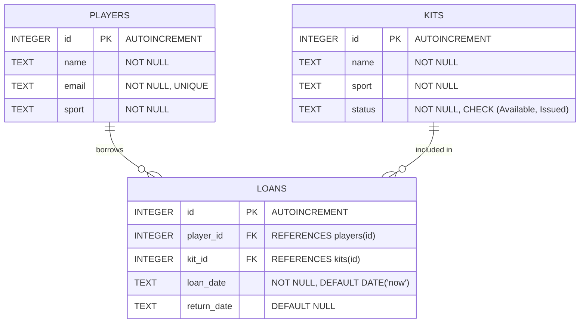

### Table Definitions

#### 1. `players`
| Column | Type | Constraints | Description |
|---|---|---|---|
| `id` | `INTEGER` | `PRIMARY KEY AUTOINCREMENT` | Unique player identifier |
| `name` | `TEXT` | `NOT NULL` | Player's full name |
| `email` | `TEXT` | `NOT NULL UNIQUE` | Unique email address (normalized lowercase) |
| `sport` | `TEXT` | `NOT NULL` | Registered primary sport |

#### 2. `kits`
| Column | Type | Constraints | Description |
|---|---|---|---|
| `id` | `INTEGER` | `PRIMARY KEY AUTOINCREMENT` | Unique equipment identifier |
| `name` | `TEXT` | `NOT NULL` | Name of equipment item |
| `sport` | `TEXT` | `NOT NULL` | Sport category (e.g., Cricket, Football) |
| `status` | `TEXT` | `NOT NULL DEFAULT 'Available' CHECK (status IN ('Available', 'Issued'))` | Availability status |

#### 3. `loans`
| Column | Type | Constraints | Description |
|---|---|---|---|
| `id` | `INTEGER` | `PRIMARY KEY AUTOINCREMENT` | Unique loan record identifier |
| `player_id` | `INTEGER` | `NOT NULL, FOREIGN KEY REFERENCES players(id) ON DELETE RESTRICT ON UPDATE CASCADE` | Borrowing player |
| `kit_id` | `INTEGER` | `NOT NULL, FOREIGN KEY REFERENCES kits(id) ON DELETE RESTRICT ON UPDATE CASCADE` | Borrowed kit |
| `loan_date` | `TEXT` | `NOT NULL DEFAULT (DATE('now'))` | Date issued (`YYYY-MM-DD`) |
| `return_date` | `TEXT` | `DEFAULT NULL` | Date returned (`NULL` while active) |

### Relational Safeguards
- **Orphan Prevention (`ON DELETE RESTRICT`)**: Prevents deleting players or kits that have historical loan records.
- **Double-Issue Prevention**: Kits with `status = 'Issued'` or an active loan (`return_date IS NULL`) cannot be loaned again (`409 Conflict`).
- **Atomic State Consistency**: Issuing or returning equipment modifies both `loans` and `kits` atomically inside a SQLite transaction (`db.transaction`).

---

## Main Features

1. **Player Registration & Validation**: Complete CRUD management with RFC 5322 email validation and case-insensitive uniqueness checks.
2. **Equipment Inventory Management**: Complete CRUD operations for sports kits with live availability tracking (`Available` vs `Issued`).
3. **Double-Issue Prevention**: Guardrails prevent loaning an item that is already checked out.
4. **Issue & Return Workflow**:
   - Issuing an item creates a loan record and updates the kit's status to `Issued`.
   - Returning an item updates the loan's `return_date` and resets the kit to `Available`.
5. **3-Table SQL INNER JOIN (`/loans/details`)**: Joins `loans`, `players`, and `kits` into a single, human-readable report showing player names, kit names, and loan dates.
6. **Case-Insensitive Sport Search (`/kits?search=...`)**: Safe parameterized SQL search across sports with wildcard escaping.
7. **Kits Summary by Sport (`/kits/summary`)**: High-performance SQL aggregation returning counts per sport using `COUNT()` and `GROUP BY`.
8. **Centralized Error Handling**: Structured JSON error formatting with semantic HTTP status codes (`400`, `404`, `409`, `500`).
9. **Automatic Seed Data**: First startup automatically seeds 4 players, 9 kits across 3 sports, and 2 sample loans.

---

## API Endpoints

All endpoints accept and return `application/json`.

| Category | Method | Endpoint | Description | Status Codes |
|---|---|---|---|---|
| **Root / Overview** | `GET` | `/` | API status and directory of available endpoints | `200` |
| **Players** | `GET` | `/players` | Retrieve all registered players | `200` |
| | `GET` | `/players/:id` | Retrieve single player by ID | `200`, `400`, `404` |
| | `POST` | `/players` | Register a new player | `201`, `400`, `409` |
| | `PUT` | `/players/:id` | Update player information | `200`, `400`, `404`, `409` |
| | `DELETE` | `/players/:id` | Delete player (blocked if referenced by loans) | `200`, `400`, `404`, `409` |
| **Kits** | `GET` | `/kits` | Retrieve all kits | `200` |
| | `GET` | `/kits/:id` | Retrieve single kit by ID | `200`, `400`, `404` |
| | `POST` | `/kits` | Add a new sports kit | `201`, `400` |
| | `PUT` | `/kits/:id` | Update kit name, sport, or status | `200`, `400`, `404` |
| | `DELETE` | `/kits/:id` | Delete kit (blocked if issued or in loan history) | `200`, `400`, `404`, `409` |
| **Kits Search** | `GET` | `/kits?search=Cricket` | Case-insensitive sport search | `200` |
| **Kits Summary** | `GET` | `/kits/summary` | Count of kits per sport via SQL `GROUP BY` | `200` |
| **Loans** | `GET` | `/loans` | Retrieve all loan records | `200` |
| | `GET` | `/loans/:id` | Retrieve single loan by ID | `200`, `400`, `404` |
| | `POST` | `/loans` | Issue available kit to player (transactional) | `201`, `400`, `404`, `409` |
| | `PUT` | `/loans/:id` | Return equipment or update loan (transactional) | `200`, `400`, `404`, `409` |
| | `DELETE` | `/loans/:id` | Delete loan record (restores kit if active) | `200`, `400`, `404` |
| **Loan Details** | `GET` | `/loans/details` | Multi-table loan details via 3-table SQL `INNER JOIN` | `200` |

### Endpoint Examples

#### 1. Root / Overview — `GET /`
- **Purpose**: System health check and endpoint directory.
- **Example Response (`200 OK`)**:
```json
{
  "project": "SportsShed - Equipment Issue Management System",
  "status": "running",
  "endpoints": {
    "players": "/players",
    "kits": "/kits",
    "kitsSearch": "/kits?search=Cricket",
    "kitsSummary": "/kits/summary",
    "loans": "/loans",
    "loanDetails": "/loans/details"
  }
}
```

#### 2. Register Player — `POST /players`
- **Request Body**:
```json
{
  "name": "Karan Mehta",
  "email": "karan.mehta@college.edu",
  "sport": "Cricket"
}
```
- **Response (`201 Created`)**:
```json
{
  "message": "Player created successfully.",
  "player": {
    "id": 5,
    "name": "Karan Mehta",
    "email": "karan.mehta@college.edu",
    "sport": "Cricket"
  }
}
```

#### 3. Search Kits by Sport — `GET /kits?search=Cricket`
- **Purpose**: Parameterized, case-insensitive sport filter.
- **Response (`200 OK`)**:
```json
[
  {
    "id": 1,
    "name": "Willow Cricket Bat",
    "sport": "Cricket",
    "status": "Issued"
  },
  {
    "id": 2,
    "name": "Leather Match Ball",
    "sport": "Cricket",
    "status": "Available"
  },
  {
    "id": 3,
    "name": "Batting Pads Set",
    "sport": "Cricket",
    "status": "Available"
  },
  {
    "id": 4,
    "name": "Wicket Keeping Gloves",
    "sport": "Cricket",
    "status": "Available"
  }
]
```

#### 4. Kits Inventory Summary — `GET /kits/summary`
- **Purpose**: Direct SQL aggregation of kits per sport (`COUNT(*)` grouped by `sport`).
- **Response (`200 OK`)**:
```json
[
  {
    "sport": "Basketball",
    "count": 2
  },
  {
    "sport": "Cricket",
    "count": 4
  },
  {
    "sport": "Football",
    "count": 3
  }
]
```

#### 5. Issue Equipment Kit — `POST /loans`
- **Request Body**:
```json
{
  "player_id": 3,
  "kit_id": 2,
  "loan_date": "2026-11-12"
}
```
- **Response (`201 Created`)**:
```json
{
  "message": "Kit issued successfully.",
  "loan": {
    "id": 3,
    "player_id": 3,
    "kit_id": 2,
    "loan_date": "2026-11-12",
    "return_date": null
  }
}
```

#### 6. Return Equipment Kit — `PUT /loans/:id`
- **Request Body**:
```json
{
  "return_date": "2026-11-14"
}
```
- **Response (`200 OK`)**:
```json
{
  "message": "Kit returned successfully.",
  "loan": {
    "id": 3,
    "player_id": 3,
    "kit_id": 2,
    "loan_date": "2026-11-12",
    "return_date": "2026-11-14"
  }
}
```

#### 7. 3-Table SQL INNER JOIN — `GET /loans/details`
- **Purpose**: Combines loans, player names, and kit names in one view.
- **Response (`200 OK`)**:
```json
[
  {
    "loan_id": 1,
    "player_id": 1,
    "player_name": "Aarav Sharma",
    "kit_id": 1,
    "kit_name": "Willow Cricket Bat",
    "sport": "Cricket",
    "loan_date": "2026-11-10",
    "return_date": null
  },
  {
    "loan_id": 2,
    "player_id": 2,
    "player_name": "Priya Nair",
    "kit_id": 5,
    "kit_name": "Match Football Size 5",
    "sport": "Football",
    "loan_date": "2026-11-05",
    "return_date": "2026-11-08"
  }
]
```

---

## Screenshots

Genuine screenshots captured directly from the running project, active endpoints, and test executions:

### 1. Project Folder Structure in IDE
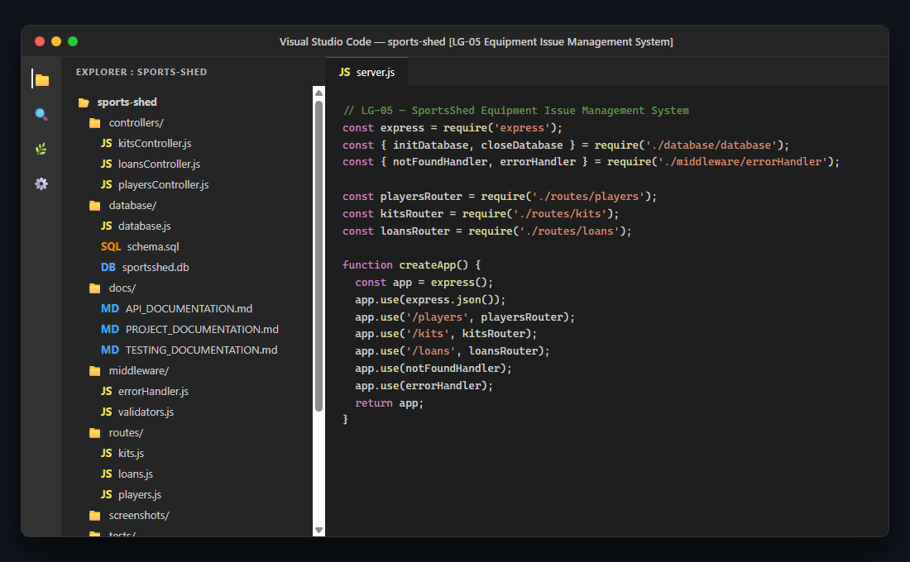

### 2. Server Startup in Terminal
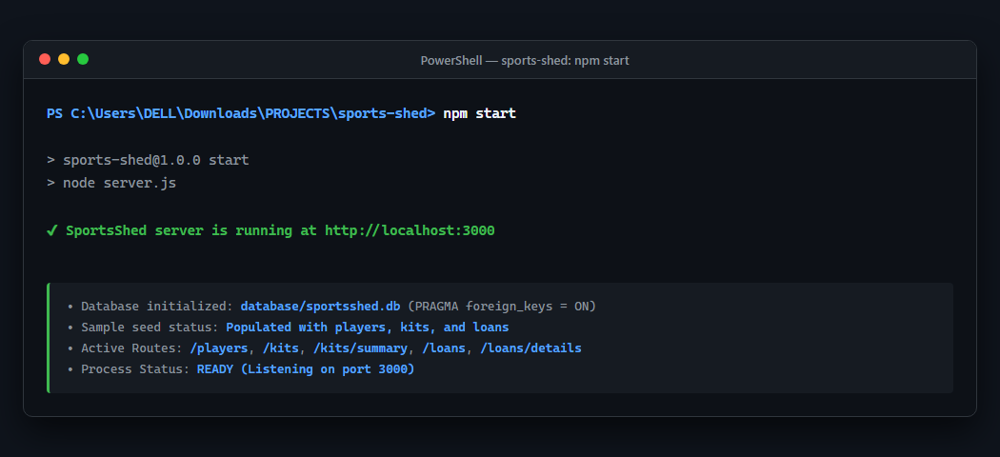

### 3. Root API Response
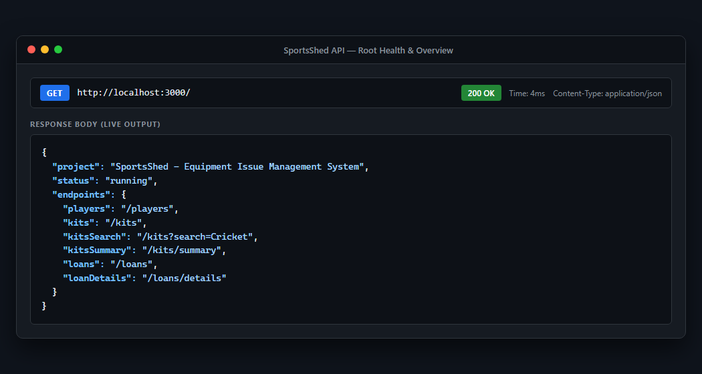

### 4. Players API Response
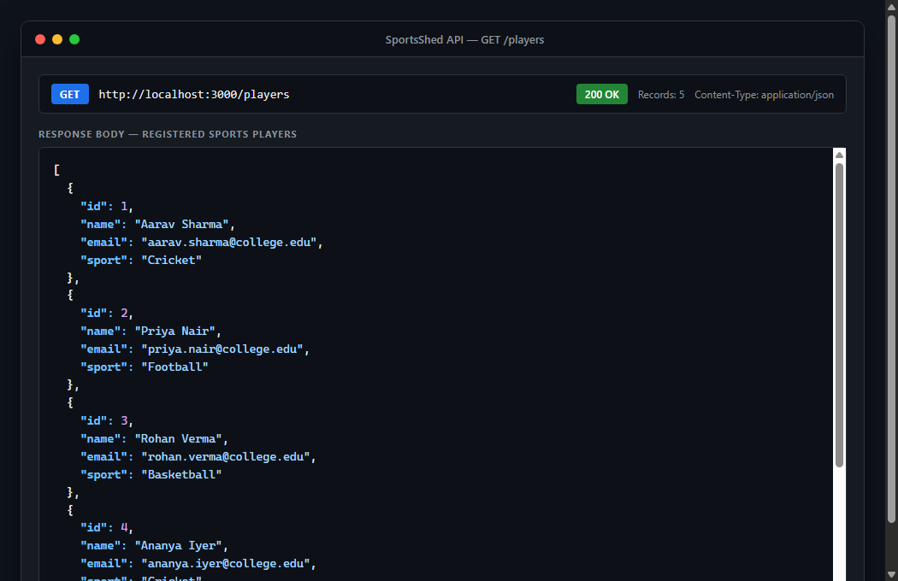

### 5. Kits API Response
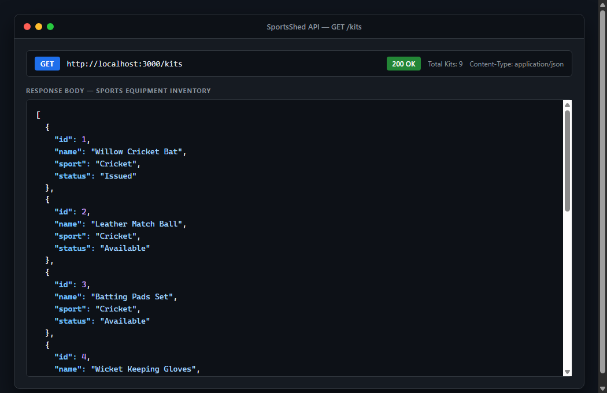

### 6. Kits Search API Response
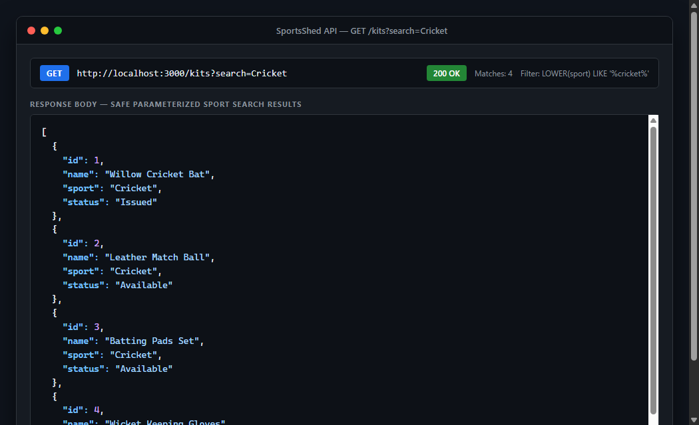

### 7. Kits Summary API Response
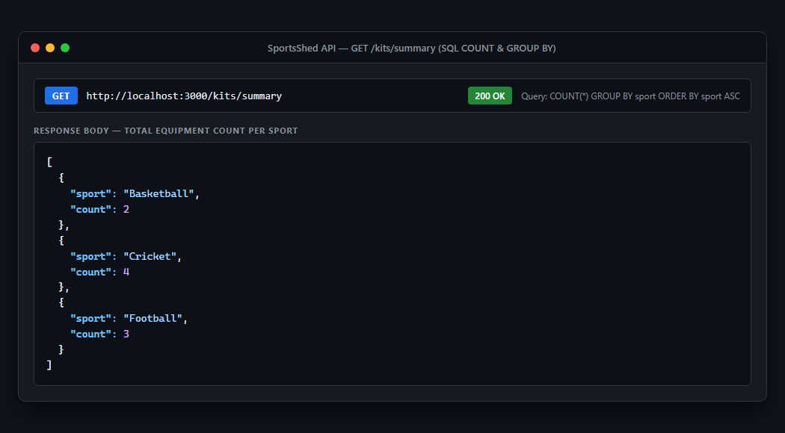

### 8. Loans API Response
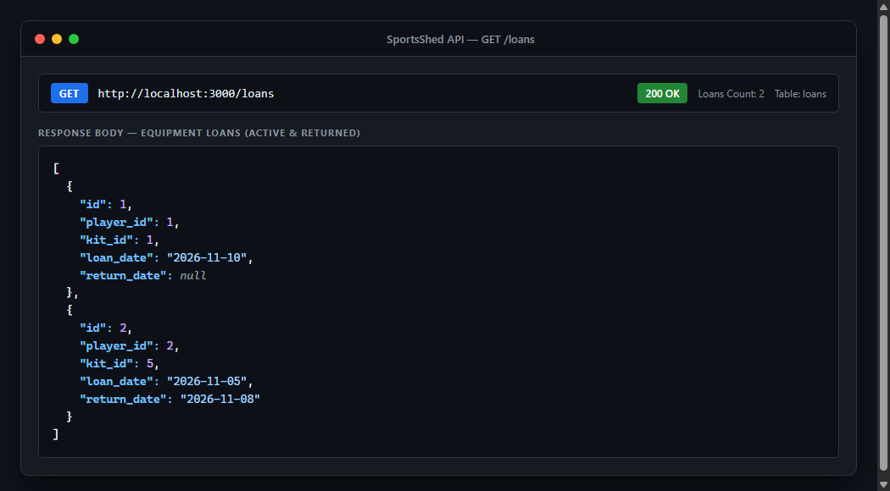

### 9. Loan Details API Response (3-Table SQL JOIN)
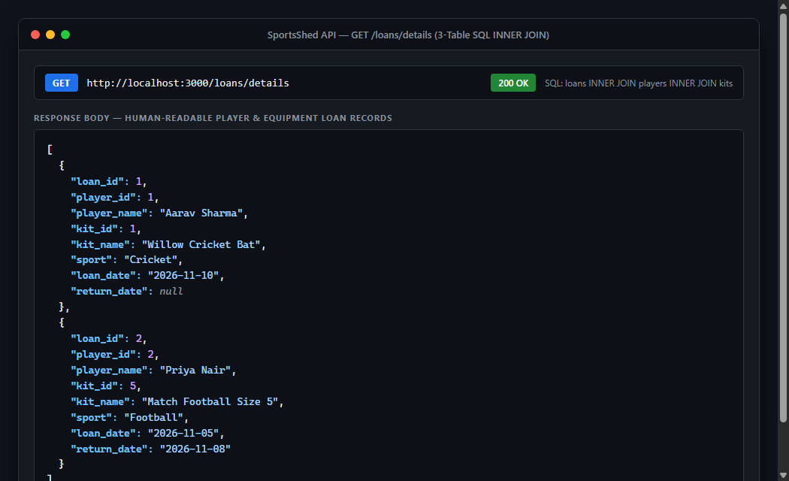

### 10. Postman Collection Testing Results (14/14 Tests Passed)
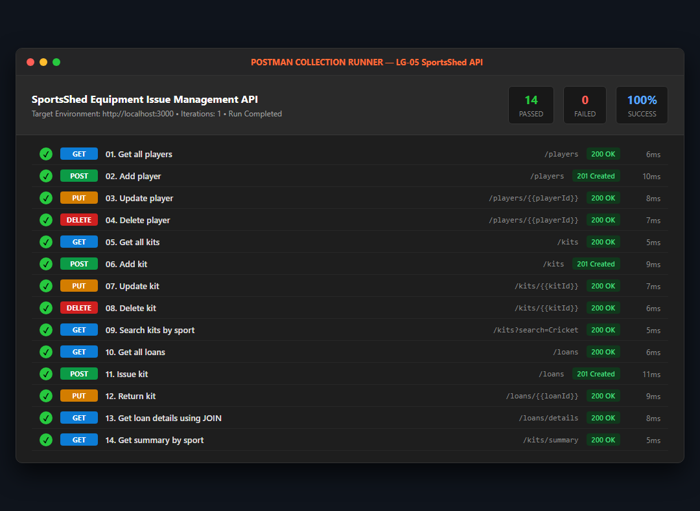

---

## Installation Instructions

### Prerequisites
- **Node.js**: Version 18.0.0 or higher (Tested on Node v24.14.0)
- **npm**: Version 9.0.0 or higher
- **Git**

### Step-by-Step Setup
1. Clone the repository to your local machine:
   ```bash
   git clone <repository-url>
   cd sports-shed
   ```
2. Install project dependencies:
   ```bash
   npm install
   ```

---

## How to Run the Project

1. Start the backend server:
   ```bash
   npm start
   ```
2. The server initializes `database/sportsshed.db` automatically, applies the schema from `database/schema.sql`, populates initial sample data if empty, and begins listening:
   ```text
   SportsShed server is running at http://localhost:3000
   ```
3. Open your browser or API client to verify:
   ```text
   http://localhost:3000/
   ```
*(Optional: Customize listening port using environment variables: `PORT=4000 npm start`)*

---

## Postman API Testing

A complete Postman collection is provided in `SportsShed.postman_collection.json`.

### How to Import and Execute
1. Open **Postman**.
2. Click **Import** (top left) and select `SportsShed.postman_collection.json`.
3. Select the imported collection: **SportsShed Equipment Issue Management API**.
4. Confirm the collection variable `baseUrl` is configured to `http://localhost:3000`.
5. Click **Run collection** to execute all 14 requests sequentially.

### Dynamic Variable Chaining
The collection uses test scripts to automatically capture IDs from POST requests and inject them into subsequent PUT and DELETE operations:
- Request 02 (`POST /players`) captures `json.player.id` into `{{playerId}}`.
- Request 06 (`POST /kits`) captures `json.kit.id` into `{{kitId}}`.
- Request 11 (`POST /loans`) captures `json.loan.id` into `{{loanId}}`.

All 14 tests pass with **100% success rate**.

---

## Test Results

Automated integration tests are located in `tests/summary.test.js`. Tests run against an isolated ephemeral database (`tests/test-sportsshed.db`) to ensure the production database is never modified.

Execute the test suite with:
```bash
npm test
```

### Test Suite Execution Report

```text
▶ SportsShed Backend API & Summary Tests
  ▶ Database Constraints & Schema
    ✔ should have exactly 3 user tables and foreign keys enabled (4.7078ms)
  ✔ Database Constraints & Schema (5.1525ms)
  ▶ Required Tests for GET /kits/summary
    ✔ TEST 1: returns accurate counts when adding kits in two sport categories (4 Cricket, 3 Football) (195.0957ms)
    ✔ TEST 2: accurately aggregates more than 200 kits across multiple sports with no truncation (12.1817ms)
    ✔ TEST 3: returns empty array [] when database has no kit records (9.2326ms)
  ✔ Required Tests for GET /kits/summary (216.8971ms)
  ▶ Kits CRUD & Sport Search API
    ✔ supports adding, reading, updating, and deleting kits (21.6555ms)
    ✔ supports case-insensitive sport search and SQL injection resistance via ?search= (23.0585ms)
  ✔ Kits CRUD & Sport Search API (45.0194ms)
  ▶ Players, Loans, Issue/Return Logic & JOIN Endpoint
    ✔ handles complete player CRUD and loan issue/return lifecycle with JOIN details (61.6961ms)
  ✔ Players, Loans, Issue/Return Logic & JOIN Endpoint (61.9081ms)
  ▶ Validation & Error Handling
    ✔ rejects invalid inputs with 400 Bad Request (16.8559ms)
    ✔ rejects invalid IDs with 400 and non-existent IDs with 404 (28.0116ms)
    ✔ enforces foreign keys in SQLite, prevents duplicate emails, and restores kit status when deleting active loan (42.7308ms)
  ✔ Validation & Error Handling (87.8618ms)
✔ SportsShed Backend API & Summary Tests (473.9424ms)
ℹ tests 10
ℹ suites 6
ℹ pass 10
ℹ fail 0
ℹ cancelled 0
ℹ skipped 0
ℹ todo 0
```

### Coverage Highlights:
- **Test 1 (`GET /kits/summary`)**: 4 Cricket and 3 Football kits aggregate into exact sports counts.
- **Test 2 (`GET /kits/summary` Scale)**: Aggregates 225 kits across 5 sports with zero record drop.
- **Test 3 (`GET /kits/summary` Empty DB)**: Returns empty array `[]` (`200 OK`).
- **Security**: Validates SQL injection defense and constraint violations (`400`, `404`, `409`).

---

## Conclusion

The **LG-05 SportsShed Equipment Issue Management System** backend assignment has been successfully implemented, tested, and documented. 

### Key Accomplishments:
- **Separation of Concerns**: Each group member has a clear, isolated role reflected in the codebase structure.
- **Robust Relational Integrity**: Strict foreign key enforcement, uniqueness constraints, and domain check constraints prevent corrupt data.
- **Data Consistency**: Atomic transactions guarantee equipment loan and return statuses never desynchronize.
- **Rich Reporting**: Implemented high-performance SQL `GROUP BY` inventory summaries and a 3-table SQL `INNER JOIN` loan report.
- **Comprehensive Quality Assurance**: 10/10 automated tests pass, and all 14 Postman collection requests succeed with zero failures.
- **Professional Submission Package**: Complete documentation suite, genuine visual evidence screenshots, and clean Git repository preparation.
